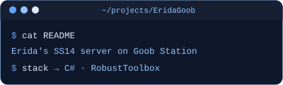
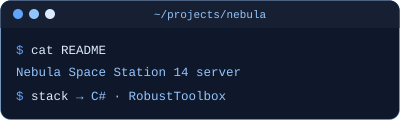
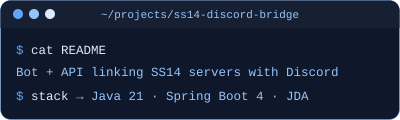

    <h2>• about •</h2>
    <h3></h3>

  I build backend services and Discord integrations for
  <a href="https://spacestation14.com/">Space Station 14</a> communities
   
  and work on C# game server forks.

 

    <h2>• projects •</h2>
    <h3></h3>

&nbsp;&nbsp;

    <h2>• stack •</h2>
    <h3></h3>

    <h2>• activity •</h2>
    <h3></h3>

